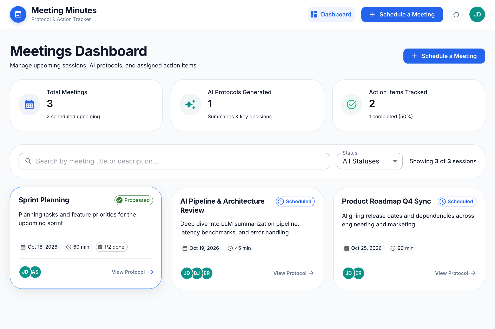
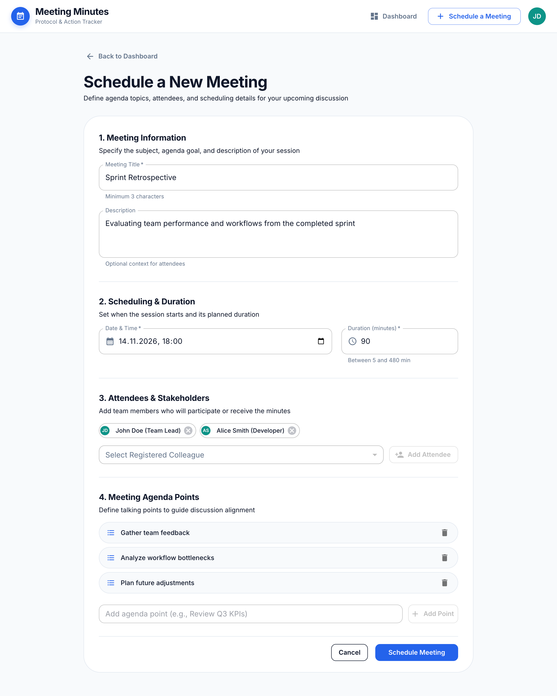
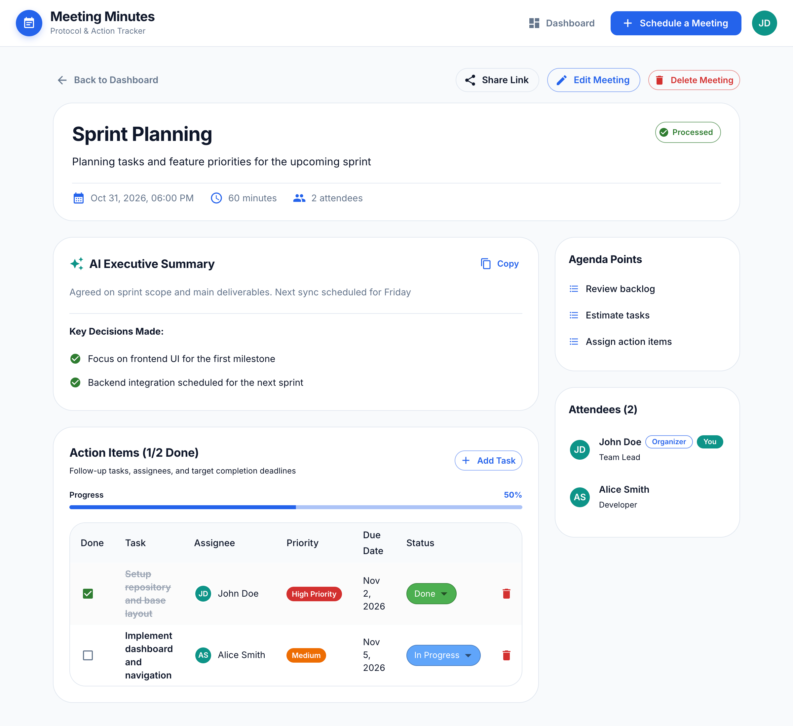

# Meeting Minutes

AI-powered assistant for organizing meetings, summarizing discussions, and tracking action items.

## Overview

Meeting Minutes simplifies team collaboration before, during, and after meetings. The app lets organizers structure agendas, simulate AI-driven transcription and summary generation, and manage actionable tasks with deadlines and assignees in a single workspace.

## Key Features

- **Authentication & Access Control:** Secure account registration and login with bcrypt password hashing. Sessions are handled via short-lived JWT access tokens and database-backed refresh tokens with revocation on logout.
- **Meeting Scheduling & Ownership:** Plan upcoming meetings with dynamic agenda items and participants. The creator automatically owns the meeting with exclusive rights to update or delete it.
- **Interactive Dashboard:** Filter meetings by status, search by keywords, view summary statistics, and track upcoming deadlines.
- **AI Protocol & Insights (Simulation):** Simulated pipeline that processes discussion recordings into structured summaries, key decisions, and action items.
- **Action Items Tracker:** Assign tasks, adjust priorities (Low, Medium, High), set due dates, and update progress (ToDo, In Progress, Done).

## Tech Stack

- **Frontend:** React 19, TypeScript, Vite, Material UI v9
- **Backend:** Python, FastAPI, SQLAlchemy, PostgreSQL, PyJWT, bcrypt
- **Infrastructure:** Docker, Docker Compose

## Architecture & Project Structure

The project follows a decoupled client-server architecture with Feature-Sliced Design (FSD) on the frontend:

```
meeting-minutes/
├── backend/
│   ├── app/
│   │   ├── api/          # Route handlers (auth, meetings, action items, users)
│   │   ├── core/         # Settings and security helpers (JWT, bcrypt)
│   │   ├── db/           # Database session, base models, and seed script
│   │   ├── models/       # SQLAlchemy models (User, Meeting, ActionItem, RefreshToken)
│   │   ├── repositories/ # Database query operations
│   │   └── schemas/      # Pydantic request and response schemas
│   └── requirements.txt
└── frontend/
    ├── src/
    │   ├── app/          # Root providers and router configuration
    │   ├── pages/        # Route views (Login, Register, Dashboard, Details, Create)
    │   ├── features/     # Feature workflows (auth context, filter, manage items)
    │   ├── entities/     # Domain components (meeting, user, action item)
    │   └── shared/       # Reusable UI, theme, and HTTP client with auto-refresh
    └── package.json
```

## Data Model

- **User:** Team members and system users (name, email, role, avatar URL, hashed password).
- **RefreshToken:** Active user sessions for issuing new access tokens with revocation support.
- **Meeting:** Session information (title, date, duration, status, AI summary, agenda, decisions) linked to an owner and participants.
- **ActionItem:** Follow-up tasks derived from meetings, assigned to a user with priority and due date.

## Getting Started

### Prerequisites

- Node.js (v18+) & npm (v9+)
- Python (v3.12+)
- Docker & Docker Compose

### 1. Database

Start the PostgreSQL database container:

```bash
docker compose up -d
```

The database will be available at `localhost:5432` (`database: meeting_minutes`, `user: postgres`).

### 2. Backend

1. Navigate to the backend folder and prepare environment configuration:
   ```bash
   cd backend
   cp .env.example .env
   ```

2. Create and activate a virtual environment:
   ```bash
   python -m venv venv
   source venv/bin/activate  # On Windows: venv\Scripts\activate
   ```

3. Install dependencies:
   ```bash
   pip install -r requirements.txt
   ```

4. Create database tables and seed initial demo data:
   ```bash
   python -m app.db.init_db
   ```

5. Run the FastAPI development server:
   ```bash
   uvicorn app.main:app --reload --port 8000
   ```

Swagger UI will be available at [http://localhost:8000/docs](http://localhost:8000/docs).

### 3. Frontend

1. Navigate to the frontend directory:
   ```bash
   cd frontend
   npm install
   ```

2. Start the Vite development server:
   ```bash
   npm run dev
   ```

The application will be available at [http://localhost:5173](http://localhost:5173).

> Pre-seeded accounts (`john@example.com` or `alice@example.com`, password: `Password123`) are available for demo purposes. Click the quick demo chips on the Sign In page to auto-fill credentials.

## Screenshots

### Meetings Dashboard (`/`)


### Meeting Creation Form (`/meetings/create`)


### Meeting Protocol & Action Items (`/meetings/:id`)

